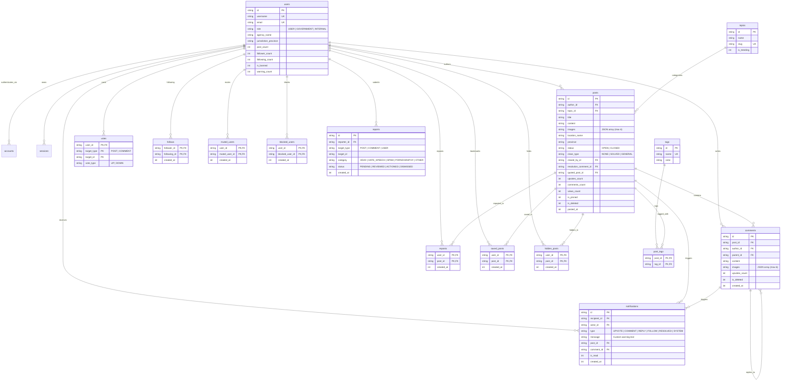

# Kavi Database Architecture & Relational Schema

This document outlines the relational data model for **Kavi** (Indonesian Civic Reporting & Public Issue Tracking Platform). Designed for **SQLite (Turso libSQL)** with **Drizzle ORM** and **NextAuth.js**.

---

## 1. Visual Entity Relationship Diagram (ERD)

---

## 2. Table Specifications & Business Logic

### `users`
- **Role Hierarchy**: `USER` (1) < `GOVERNMENT` (2) < `INTERNAL` (3).
- **Verified Badges**:
  - `GOVERNMENT`: Green verified badge. Uses `agency_name` (e.g., *"Pemerintah Daerah Kalimantan Utara"*) and `jurisdiction_province` (*"Kalimantan Utara"*).
  - `INTERNAL`: Red verified badge (core development/moderation team).
  - `USER`: Regular citizen.
- **Counters**: `post_count`, `follower_count`, and `following_count` are stored directly on the row to allow instantaneous $O(1)$ reads on user hover cards.
- **Account Moderation**: `is_banned` halts requests immediately; `warning_count` tracks progressive strikes.

### `posts`
### Feed Tabs vs Right Sidebar Trending Widget

- **Center Home Feed Tabs**:
  - **For You** (`tab=foryou`): Main default stream. Active reports sorted by recent community activity and relevance.
  - **Following** (`tab=following`): Only reports authored by users the current citizen follows (`author_id IN (SELECT following_id FROM follows)`).
  - **Past / Archive** (`tab=past`): All finalized reports (`status = 'CLOSED'`), including `SOLVED` and `GENERAL` resolutions.

- **Right Sidebar: Trending Widget (Twitter/X style)**:
  - Fixed on the right column of the desktop layout.
  - Periodic snapshot (refreshes every few hours / cached):
    1. **Trending Topics**: Macro topics with `is_trending = 1` or highest post volume in the last 24h.
    2. **Trending Issues (Hot/Views/Upvotes)**: Top viral and high-impact reports highlighted in the sidebar widget.
    3. Endpoint: `GET /api/trending?mode=hot|views|upvotes`.
- **Thread Closure & Resolution**:
  - `status = 'CLOSED'` closes comment submissions.
  - `close_type = 'SOLVED'` displays the solved checkmark badge.
  - `resolution_comment_id` points to the specific official comment providing the solution. The UI "View Response" button scrolls directly to `#comment-${resolution_comment_id}`.
- **Visual Evidence**: `images` stores a JSON array of up to 6 image URLs.

### `comments`
- **Self-referencing tree**: `parent_id` references `comments.id` for nested replies.
- **Soft deletion**: `is_deleted = 1` retains comment tree structure without displaying toxic or retracted text.

### `topics` vs `tags`
- **`topics`** (Macro Scope, Curated): Predefined official categories (e.g., `BencanaNasional`, `Infrastruktur`). Each post belongs to exactly 1 primary topic.
- **`tags`** (Micro Scope, Free-form): Created and attached freely by users (e.g., `#Karhutla`, `#ToneDeaf`). Linked via many-to-many `post_tags`.

### Moderation & Context Actions
- **Bookmark / Save**: Stored in `saved_posts`.
- **Hide from Feed**: `hidden_posts` is excluded in feed queries via `NOT IN (SELECT post_id FROM hidden_posts WHERE user_id = :current_user)`.
- **Mute**: `muted_users` hides posts and comments from the muted user without their knowledge.
- **Block**: `blocked_users` enforces a strict mutual barrier (cannot see profiles, interact, or follow).
- **Reports**: Stored in `reports` with review statuses (`PENDING`, `REVIEWED`, `ACTIONED`, `DISMISSED`).
- **Notifications**: Includes a nullable `message` column for direct, custom administrative warnings (`SYSTEM`).
